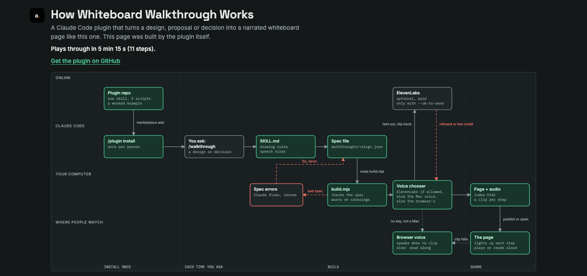

# Whiteboard Walkthrough

A Claude Code plugin that turns a design, proposal or decision into one narrated whiteboard page: a drawing of the
system (lanes for where things run, columns for when, new vs existing vs changed parts, the failure path) and 8 to 12
spoken steps that light up their part of the board as they play. It ends with the decision and a recommendation.

## See it explain itself

[](https://aios.cx/walkthrough/)

**[Watch the walkthrough](https://aios.cx/walkthrough/)** (about 5 minutes, with sound). The page was made by this
plugin from [`docs/how-it-works.json`](docs/how-it-works.json), so it shows both how the plugin works and what it
makes.

## Install

In Claude Code:

```
/plugin marketplace add djdub/whiteboard-walkthrough
/plugin install whiteboard-walkthrough@whiteboard-walkthrough
```

Needs Node 18 or later.

## Use

Ask for it in any chat: "/walkthrough the design in docs/queue.md", "whiteboard this proposal", "walk me through it".
Claude writes a spec at `walkthroughs/<slug>.json`, builds `walkthroughs/<slug>/index.html` with its audio, and shares
it (a claude.ai Artifact if your Claude Code has one, otherwise a local file you can open or host anywhere).

## Voices

| Voice | Needs | Cost | Text leaves your machine |
|---|---|---|---|
| Qwen (`--voice qwen`) | a Mac with Apple Silicon on macOS 14 or later, Python 3.11 to 3.14, and a one-time setup (below) | free | no |
| Mac built-in (`--voice say`) | macOS | free | no |
| Browser (`--voice browser`) | nothing; the page speaks with the reader's browser voice | free | no |
| ElevenLabs (`--voice elevenlabs`) | `ELEVENLABS_API_KEY`, and `--ok-to-send` on each build | roughly 900 to 1,000 credits per five-minute page | yes |

The default, `--voice auto`, uses ElevenLabs only when a key is set and `--ok-to-send` is passed; otherwise Qwen if it
is set up, otherwise the Mac voice, otherwise the browser. Optional: `ELEVENLABS_VOICE_ID` (default "George"), `ELEVENLABS_MODEL`,
`WALKTHROUGH_SAY_VOICE` (default "Daniel"). The builder then deletes each ElevenLabs history item and warns if a deletion fails; credits are logged in
`walkthroughs/<slug>.cost.jsonl`, beside the spec and outside the page's folder.

### The Qwen voice: natural, and nothing leaves your Mac

Qwen3-TTS (an open model from Alibaba, Apache 2.0) runs on the Mac's GPU through
[mlx-audio](https://github.com/Blaizzy/mlx-audio). Every page is read by the same narrator, cloned from the short
sample in `skills/walkthrough/voices/narrator.wav` (a synthetic voice, not a recording of a person). Set it up once:

```
node skills/walkthrough/scripts/build.mjs --setup-voice qwen
```

That makes a private Python environment and downloads the model (about 4.5 GB) at a fixed revision. Every Python
package is pinned by hash in `skills/walkthrough/scripts/qwen-requirements.txt` and installed from wheels only. The
environment, the model and pip's download cache all go in `~/.cache/whiteboard-walkthrough` (set `WALKTHROUGH_HOME` to
move it); delete that folder to remove the voice. It needs Python 3.11 to 3.14: macOS ships 3.9, so install one from
python.org or your package manager, and set `WALKTHROUGH_PYTHON` if it is not on your PATH as `python3.11` to
`python3.14`. The setup ends by voicing a test sentence; running it again on a working install only checks it, offline.

The voice runs inside macOS's own sandbox (`sandbox-exec`) with every network operation denied, so the step text cannot
leave your Mac; if the sandbox is missing, it refuses to voice. Voicing takes about as long as the audio plays (a
five-minute page in about five minutes on an M-series Mac).

If an audio file fails to load, the page reads that step with the browser voice; with no voice at all, the text is on
screen to read along. The page loads its fonts from Google Fonts; offline, or where that is blocked, it uses system
fonts.

## Try it

```
node skills/walkthrough/scripts/build.mjs skills/walkthrough/examples/order-refunds.json --voice browser
open skills/walkthrough/examples/order-refunds/index.html   # macOS; elsewhere open the file in a browser
```

## Tests

```
node --test test/*.test.mjs
WALKTHROUGH_QWEN_LIVE=1 node --test test/qwen-live.test.mjs   # the real Qwen model, after --setup-voice qwen
```

The Qwen tests that run a stand-in worker need an Apple Silicon Mac (they go through `sandbox-exec`); elsewhere they
are skipped.

## Layout

- `.claude-plugin/plugin.json`, `.claude-plugin/marketplace.json`: the plugin and its one-plugin marketplace
- `skills/walkthrough/SKILL.md`: the procedure Claude follows
- `skills/walkthrough/scripts/`: `build.mjs` (checks the spec, voices the steps, writes the page), `voice.mjs`,
  `voice_qwen.py` (the Qwen worker), `qwen-requirements.txt` (its packages, pinned by hash), `player.html`
- `skills/walkthrough/voices/`: the Qwen narrator's voice sample and its transcript
- `skills/walkthrough/examples/order-refunds.json`: a worked spec to copy
